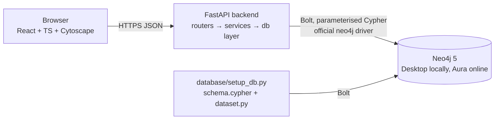

# Architecture

## Layers
| Layer | Location | Responsibility |
|---|---|---|
| UI | `frontend/src` | 9 routed pages, theme provider, shared `GraphView` (Cytoscape), API client with typed errors |
| API | `backend/app/routers` | HTTP contract, validation (Pydantic / path patterns), status codes, error envelope `{error:{code,message}}` |
| Services | `backend/app/services` | Risk rules (`risk.py`), Lab template validation/execution (`lab.py`), bounded graph builders (`graphs.py`) |
| DB | `backend/app/db.py` | Pooled driver, `execute_read/execute_write`, serialisation of Node/Relationship/Path/temporal types into graph DTOs |
| Data | `database/` | Constraints/indexes (`schema.cypher`), deterministic dataset, loader/validator CLI, Cypher catalogue |

## Key design decisions
* **Credentials only on the backend** (`.env`); the browser talks to FastAPI only.
* **Graph DTO**: `{nodes:[{id:"Label:key",label,name,properties}], edges:[{id,source,target,type,properties}]}`. Edges are emitted only when both endpoints were returned by Neo4j, so the UI never draws an invented or dangling relationship.
* **Bounded retrieval**: `LIMIT` in queries, `MAX_GRAPH_NODES`, neighbour expansion capped at ≤100 per call, shortest path ≤10 hops.
* **Allowlists** for labels, relationship types and Lab templates; write templates only touch `TEST-*` nodes flagged `isTestRecord`.
* **Fail-fast outages**: driver retry capped at 3 s; `/api/health` never reports "connected" unless `verify_connectivity()` succeeds; UI shows API offline / disconnected states.
* **Theme**: CSS variables on `<html data-theme>`; set by an inline script before first paint; Cytoscape styles are rebuilt from the variables on change.

## Endpoints (25)
Health/overview · graph (demo, search, neighbors, node, relationship, path) · medicines (list, graph) · traceability (batch, report) · risk (findings, finding) ·
recall (list, impact, report) · crud (create/read/update/link/delete test batches) · lab (queries, run) · insights. Interactive docs at `/docs` in development.

## Deployment topology
Local: Neo4j Desktop ↔ uvicorn :8000 ↔ Vite :5173. Online: Vercel (static SPA + rewrites) → Render (FastAPI) → Aura (separate hosted database). See `DEPLOYMENT.md`.
