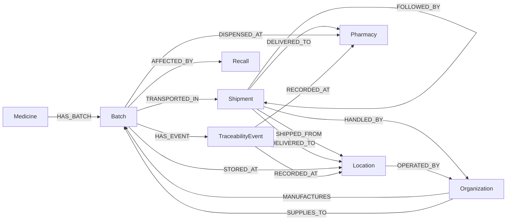

# Graph Schema

PharmaTrace uses a Neo4j **property graph**. All data is synthetic.

## Role model
One `Organization` label with a `role` property: `Manufacturer`, `Supplier`, `Distributor`, `WarehouseOperator`.
Role-specific meaning is carried by the relationship (`MANUFACTURES`, `SUPPLIES_TO`, `HANDLED_BY`, `OPERATED_BY`), and the
risk rules rely on those relationships rather than trusting `role` alone.

## Nodes
| Label | Key (unique) | Other properties |
|---|---|---|
| Medicine | `medicineId` | `name`, `drugCode`, `category`, `form` (Tablet/Capsule/Bottle/Vial/Box; drives product illustration) |
| Batch | `batchId` | `lotNumber`, `manufacturingDate` (date), `expiryDate` (date), `quantity`, `status`, `intendedRegion`, `isTestRecord` (only on TEST-* nodes) |
| Organization | `organizationId` | `name`, `role`, `verificationStatus` (Verified/Pending/Unverified), `region` |
| Location | `locationId` | `name`, `region`, `locationType` (ManufacturingSite/Warehouse) |
| Shipment | `shipmentId` | `departureTime`, `arrivalTime` (null while in transit), `quantity`, `status` |
| Pharmacy | `pharmacyId` | `name`, `region`, `verificationStatus` |
| Recall | `recallId` | `reason`, `issuedAt`, `status` (Active/Closed) |
| TraceabilityEvent | `eventId` | `eventType` (MANUFACTURED, QC_RELEASED, SHIPPED, RECEIVED, DELIVERED), `timestamp`, `description` |

Additions beyond the suggested schema (and why): `Batch.lotNumber` (needed to express conflicting identifiers, since a unique constraint on
`batchId` makes literal duplicates impossible), `Batch.intendedRegion` (needed to define an "unexpected route"), `Medicine.form`
(drives product artwork), `Shipment` leg chaining via `FOLLOWED_BY`.

## Relationships (direction matters)
| Type | From → To | Properties | Meaning |
|---|---|---|---|
| HAS_BATCH | Medicine → Batch | – | Production run of a medicine |
| MANUFACTURES | Organization → Batch | – | Manufacturer of the batch |
| SUPPLIES_TO | Organization → Batch | `material` | Supplier of an input material used in the batch |
| TRANSPORTED_IN | Batch → Shipment | – | Batch travels in this shipment leg |
| FOLLOWED_BY | Shipment → Shipment | – | Downstream leg of the same movement |
| SHIPPED_FROM | Shipment → Location | – | Origin |
| DELIVERED_TO | Shipment → Location \| Pharmacy | – | Destination (absent = incomplete path) |
| HANDLED_BY | Shipment → Organization | – | Distributor/carrier |
| STORED_AT | Batch → Location | – | Warehouse holding the batch |
| DISPENSED_AT | Batch → Pharmacy | – | Batch stock reached/stocked at the pharmacy |
| AFFECTED_BY | Batch → Recall | – | Batch is in scope of the recall |
| HAS_EVENT | Batch → TraceabilityEvent | – | Lifecycle event of the batch |
| RECORDED_AT | TraceabilityEvent → Location \| Pharmacy | – | Where the event was recorded |
| OPERATED_BY | Location → Organization | – | Operator of the site |

`DISPENSED_AT` here means "stock delivered to and held at the pharmacy"; individual dispensing transactions are **not** modelled.

## Integrity
* 8 uniqueness constraints (one per label key) + 9 secondary indexes: `database/schema.cypher` (17 idempotent statements).
* Existence constraints are Enterprise-only, so required fields, quantity > 0, expiry > manufacture, `TEST-` prefix rules, and allowed enums are enforced in Pydantic/the Lab parameter validator.
* Loading uses `MERGE`, so re-running `setup_db.py load` never duplicates data.
